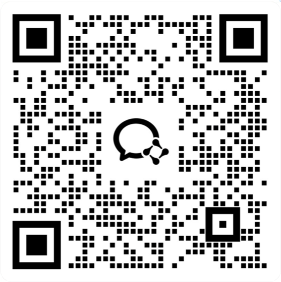

<p align="center"></p>

<p align="center"></p>
<p align="center"><sub>Independent third-party advisor · Unofficial product · RC1 for internal trials</sub></p>

# Tiger Roar Awards Advisor

**Evidence-driven marketing value decisions** · v2.0.0-rc.1

Developed by Qomob.AI, based on SkillBuddy. [简体中文](README.md)

Tiger Roar Awards Advisor is an independent Agent Skill for brands, agencies, creative teams and marketing technology providers. It evaluates whether a campaign merits an award submission before helping write it. It examines business challenges, audience insights, strategy, creative differentiation, execution, outcomes and the quality of supporting evidence. It can recommend against an unsuitable category or a weak campaign when supported by reviewed evidence; missing evidence remains unknown, not a low score.

This is not an official Tiger Roar Awards product, does not represent the organizer or judges, and makes no award guarantees. WorkBuddy was the original distribution target of the SkillBuddy-generated V1.1.0 baseline. Actual host compatibility remains untested.

## Quick start

Import the repository directory containing `SKILL.md` and its supporting files using your host's documented Skill mechanism. Upload only authorized project materials. Ask the assistant to independently assess award eligibility, marketing value, category fit, evidence and counterevidence before drafting a submission. Treat unsigned judgments as provisional.

For the local CLI, use Python 3.10+, Ed25519-capable OpenSSL for signature verification and ffprobe for media probes. No third-party Python packages are required.

```bash
python3 scripts/roar.py catalog --group special --profiles
python3 scripts/roar.py fees --major 2 --excellent 1
python3 scripts/roar.py score special-01 8 7 8 6
python3 scripts/roar.py audit examples/v2/project.json --evidence-root examples/v2
python3 -m unittest discover -s tests -v
```

The synthetic unsigned audit example is expected to return exit code 2 (`REVIEW`). `score` is arithmetic, not validated professional judgment. Audit exit codes are 0 (`INTERNAL_REVIEW_ATTESTED`), 2 (`REVIEW`), and 3 (`BLOCKED`); none implies official award approval.

## Architecture and evidence

The model handles open-ended professional analysis and writing; the CLI checks rule constraints, structured evidence, weighted scores, file bindings and selected media properties. Independent reviewers must check authenticity, project identity, attribution and rights, then sign the reviewed snapshot outside model control. Signatures do not prove real-world truth; the host must independently enforce its trust root and access controls. Final text verification covers exact bound UTF-8 fact text, not arbitrary prose, visual content, slides or films.

## Release maturity

- 18th edition (2026–2027) handbook-derived rule snapshot; 95 catalog entries including 12 nomination-only entries; 83 direct-entry advisory profiles.
- Eight public historical research leads, not an independently verified official dataset.
- 76 automated tests: 37 historical regression and 39 V2 tests. These validate bounded software behavior, not real judging expertise.
- Real model comparisons, authorized campaign blind reviews, current authenticated submission fields and actual host validation remain pending.
- Release candidate for internal trials; production acceptance is NO-GO.

## Documentation

[Skill entry](SKILL.md) · [User guide](docs/USER_GUIDE.md) · [Architecture](docs/ARCHITECTURE.md) · [Runtime guide](references/runtime-guide.md) · [Acceptance](ACCEPTANCE.md) · [Evaluation protocol](evaluation/PROTOCOL.md) · [Security](SECURITY.md) · [Contributing](CONTRIBUTING.md) · [Changelog](CHANGELOG.md)

Official sources: [Tiger Roar](https://www.hooxiao.com/), [submission portal](https://case.hooxiao.com/), [international portal](https://encase.hooxiao.com/). Source details and verification limitations are in [source notes](references/source-notes.md). The original handbook PDF and private customer materials are not bundled.

Source code is released under the [MIT License](LICENSE), copyright QOMOB.AI. Third-party names, marks and brand assets are excluded from that license and remain with their respective owners. See [NOTICE](NOTICE.md).

## Brand assets

[Cover and logo notes](docs/BRAND_ASSETS.md) · [Release guide](docs/RELEASE.md).

## Community

<p align="center"></p>
<p align="center"><sub>Scan to join the SkillBuddy community</sub></p>
