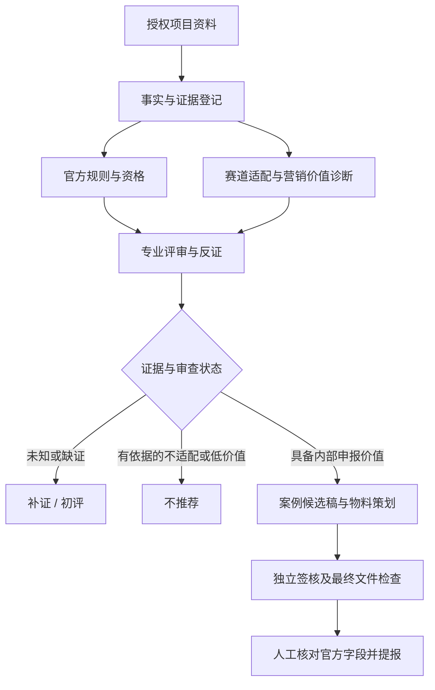

<p align="center"></p>

<p align="center"></p>
<p align="center"><sub>独立第三方参赛顾问 · 非官方产品 · RC1 内部试用候选版</sub></p>

<h1 align="center">Tiger Roar Awards Advisor</h1>
<p align="center"><strong>虎啸奖报名顾问 · 证据驱动的营销价值决策系统</strong></p>
<p align="center">Developed by Qomob.AI · Based on SkillBuddy · v2.0.0-rc.1</p>
<p align="center"><a href="README.en.md">English</a> · <a href="docs/USER_GUIDE.md">使用指南</a> · <a href="docs/ARCHITECTURE.md">架构</a> · <a href="ACCEPTANCE.md">验收报告</a></p>

> **先判断项目值不值得报，再决定如何表达。**

## 项目简介

虎啸奖报名顾问是一款面向品牌营销团队、广告代理公司、数字营销机构、创意团队及技术服务商的独立专业 Agent Skill。它不以生成漂亮的案例为唯一目的，而是通过商业问题诊断、营销策略与创意判断、证据审查、赛道选择和模拟评审，帮助团队作出有依据的参赛决策。

一个真正专业的报奖顾问既能发现优秀项目尚未被充分表达的价值，也能否定证据充分但价值不足的项目；资料不足时，则保留未知，而不是随意给出高分或低分。

**非虎啸奖官方产品，不代表组委会或评委，不承诺获奖。当前为内部试用候选版，正式生产验收尚未通过。**

## 为什么做这个项目

| 常见问题 | 本项目的解决方向 |
| --- | --- |
| 项目很多，不知道先报哪个 | 商业价值诊断、赛道比较和申报投入决策 |
| 有传播数据，却不能证明真实效果 | 原件、事实、指标、归因及反证治理 |
| 使用 AI 就被包装成 AI 创新 | 核心贡献与相邻赛道的适配判断 |
| 模拟评委全部给高分 | 证据约束、未知区间及独立签核 |
| 报名稿被反复修改，审查失效 | 最终事实文本反向检查及签核快照 |

## 核心能力

- **懂营销**：诊断市场、用户洞察、策略选择与执行机制。
- **懂创意**：区分常规执行与原创贡献，审视品牌相关性和差异化。
- **懂商业**：判断经营价值、项目目标、实际效果及报奖资源投入。
- **懂数据**：审查指标定义、范围、期间、对照、证据来源与冲突。
- **懂评审**：按类别权重开展多视角模拟评审，保留反证与未知。
- **敢于否定**：有依据地排除不适配赛道和低价值项目，不以缺证代替低分。

## 品牌与产品关系

```text
Qomob.AI                 开发者 / 产品署名
└── SkillBuddy           Skill 生成及工程化体系
    └── Tiger Roar Awards Advisor
        └── WorkBuddy 等支持 Agent Skill 的运行环境（兼容性待实测）
```

本版以 SkillBuddy 生成的 B 版 V1.1.0 为开发基线，并恢复 A 版 V1.0.0 的回归测试。WorkBuddy 是原发行适配环境，不是开发框架。本次仓库整理不代表重新运行 SkillBuddy 生成流程。

## 快速开始

### 在支持 Skill 的宿主中使用

1. 获取仓库完整内容，保留 `SKILL.md` 及相邻目录。
2. 按宿主的 Skill 导入机制导入项目目录；如需 ZIP，按宿主实际要求打包。
3. 上传经授权的项目资料，使用下面的示例指令。实际宿主安装及运行兼容性尚未验证。

```text
调用虎啸奖报名顾问，先独立判断附件项目是否值得报奖。
分析商业问题、用户洞察、策略、创意、执行与实际效果。
按第18届规则给出主报、备选及不推荐赛道，登记证据、反证与未知项。
先做决策，再决定是否投入案例撰写。不要编造数据，不要迎合我。
无独立签核时保持初步评估，明确程序是否实际执行。
```

### 本地离线 CLI

要求 Python 3.10+；签核验证需要支持 Ed25519 的 OpenSSL；真实媒体技术属性检查需要 ffprobe。Python 脚本不依赖第三方 Python 包。所有命令在仓库根目录运行。

```bash
python3 scripts/roar.py --help
python3 scripts/roar.py catalog --group special --profiles
python3 scripts/roar.py fees --major 2 --excellent 1
python3 scripts/roar.py score special-01 8 7 8 6
python3 scripts/roar.py audit examples/v2/project.json --evidence-root examples/v2
python3 -m unittest discover -s tests -v
```

示例审计的预期退出码是 **2（REVIEW）**：它使用合成数据且没有独立签核，不能用于正式申报。`score` 仅计算输入分数的加权值。详见 [运行指南](references/runtime-guide.md)。

## 工作原理



大模型负责开放性专业判断，确定性程序负责规则、结构、算术、证据及文件检查。独立审查人负责证据真实性、归因、权限和专业判断签核。七个引擎是逻辑能力模块，不代表七个独立服务。

| 决策状态 | 含义 |
| --- | --- |
| `PRIORITY_INTERNAL` | 签核及价值检查支持优先内部申报 |
| `CONDITIONAL` | 仍需补强或满足条件 |
| `INSUFFICIENT_EVIDENCE` | 缺证或评审未知，不能确定高低价值 |
| `NOT_RECOMMENDED_CATEGORY` | 有依据否定指定赛道，不否定整个项目 |
| `NOT_RECOMMENDED` | 已签核且有反证支持的低价值判断 |
| `BLOCKED` | 存在程序识别的实质性阻断 |

价值判断与交付门禁分离。`INTERNAL_REVIEW_ATTESTED` 不等于官方审批或正式报名成功。

## 当前版本与验证范围

| 项目 | RC1 状态 |
| --- | --- |
| 赛事规则 | 第18届（2026–2027）参赛手册派生快照 |
| 类别库 | 95个类别及提名条目；83个直接申报类顾问条件 |
| 历史案例 | 8条公开研究线索，非官方独立核验的完整案例库 |
| 自动化测试 | 76项：37项历史回归 + 39项V2测试 |
| 真实模型四组盲测 / 真人盲评 | 未执行 |
| 官方后台字段 / 实际宿主兼容性 | 尚未核验 |
| 发布裁决 | 内部试用候选；生产 NO-GO |

测试证明的是特定程序行为，不证明 AI 已具有真实评委的判断能力。参见 [ACCEPTANCE.md](ACCEPTANCE.md) 和 [验证计划](evaluation/PROTOCOL.md)。

## 文档与工程结构

| 文件/目录 | 用途 |
| --- | --- |
| [SKILL.md](SKILL.md) | Agent Skill 入口及行为契约 |
| [docs/USER_GUIDE.md](docs/USER_GUIDE.md) | 使用指南与示例 |
| [docs/ARCHITECTURE.md](docs/ARCHITECTURE.md) | 逻辑架构、证据模型与决策边界 |
| [references/](references/) | 赛事快照、赛道条件、运行指南、历史研究 |
| [workflows/](workflows/) | 专业工作流 |
| [scripts/](scripts/) | V2审计 CLI 与历史规则内核 |
| [tests/](tests/) / [examples/](examples/) | 回归、对抗测试及合成样本 |
| [evaluation/](evaluation/) | 待执行真实专业盲评方案 |
| [SECURITY.md](SECURITY.md) | 安全与信任边界 |
| [CONTRIBUTING.md](CONTRIBUTING.md) | 贡献及规则更新指南 |
| [docs/ROADMAP.md](docs/ROADMAP.md) | 下一阶段验证路线 |
| [CHANGELOG.md](CHANGELOG.md) | 版本历史 |

## 来源、隐私与权利

规则主要依据《第18届虎啸奖（2026–2027）参赛手册》派生整理；具体页码、源文件 SHA-256 和访问状态见 [来源说明](references/source-notes.md)。官方入口：[虎啸网](https://www.hooxiao.com/) · [中文提报](https://case.hooxiao.com/) · [国际提报](https://encase.hooxiao.com/)。官方后台字段与补充规则尚未核验；参赛以当届官方最新要求为准。

仓库不附原始官方手册 PDF、真实客户资料、生产签核私钥或完整第三方获奖案例。示例为合成测试数据。第三方奖项名称与商标归其各自权利人；本项目不宣称官方授权或合作。使用宿主时应另行确认其数据处理政策。

本项目源码采用 [MIT 许可证](LICENSE)，版权所有 QOMOB.AI。第三方名称、商标及品牌素材不在该许可范围内，其权利归各自权利人。参见 [权利说明](NOTICE.md)。

## 参与贡献

欢迎通过问题报告提交规则错误、证据边界案例和可复现的测试建议。不要在公开 Issue 中提交客户原件、个人信息、访问凭据或密钥。贡献要求见 [CONTRIBUTING.md](CONTRIBUTING.md)。

## 品牌素材

[封面与 Logo 说明](docs/BRAND_ASSETS.md) · [GitHub 发布手册](docs/RELEASE.md)。

## 社群

<p align="center"></p>
<p align="center"><sub>扫码加入 SkillBuddy 社群</sub></p>
