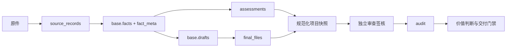

# 技术与专业能力架构

[返回首页](../README.md)

## 职责分离

| 层 | 责任 | 实现 |
| --- | --- | --- |
| 意图路由 | 按需加载规则、接待、写作、评审和交付 | SKILL.md |
| 专业判断 | 商业、营销、创意、赛道机制、反证 | workflows、references |
| 规则与证据约束 | 结构、资格、计数、哈希、行号、指标冲突、区间 | scripts/roar.py、scripts/legacy.py |
| 独立审查 | 原件真实性、归属、口径、授权、专业评分 | 模型控制范围外的真实审查人 |
| 最终交付 | 绑定文本、媒体属性与人工确认 | V2 audit、delivery 工作流 |

七个逻辑引擎分别是 Evidence、Rule、Category、Value、Benchmark、Jury、Delivery；并非七个进程或独立部署服务。CLI 不实现语义自动分类或真实数据自动认证。

## 数据流与契约

V2 顶层字段：schema_version、base、author_id、reviewer_id、source_records、fact_meta、assessments、final_files、media_files、portfolio。详见 [真实运行契约](../references/runtime-guide.md) 及 [合成示例](../examples/v2/project.json)。

证据层区分字节完整性、摘录绑定、项目归属、指标一致性、来源可信度、因果解释与公开权限。文件哈希只证明字节匹配，不证明原件真实性。指标冲突键基于规范化名称、单位、范围、期间、对照等结构；复杂别名和语义冲突需人工核对。

## 决策模型

按类别真实权重计算已经过可信签核的维度贡献。未知维度的贡献范围为0到该维度权重；总区间为已知贡献至已知贡献加未知权重。低于7分的维度必须提供反证，支持与反证不可重叠。未经签核的高低分均不能产生确定价值判断。0权重维度也有解释要求。内部优先阈值85，低于70可在必要条件完备时不推荐；不是官方分数线。

全局P0阻断覆盖价值结论。类别不适配只否定该赛道；价值建议可先于最终稿制作。最终绑定文本必须与登记稿逐行一致；媒体检查只覆盖实际文件哈希、字节数及可用时的 ffprobe 属性。`audit` 退出码0/2/3分别代表 INTERNAL_REVIEW_ATTESTED/REVIEW/BLOCKED。

## 信任模型

数字签名验证由支持 Ed25519 的 OpenSSL 完成，公钥和签名通过外部可信渠道供应。CLI 不负责账户、角色权限、密钥撤销或强制独立性，无法防止不可信操作者自行替换公钥。项目字段、审查人姓名与自报确认都不是独立授权。必须由宿主隔离密钥、管理信任根并冻结审查文件。见 [安全说明](../SECURITY.md)。

## 知识与测试

95个目录条目（含12个提名类），83个直接申报类具备顾问条件；规则为第18届手册派生摘要，未逐条重新转录完整原文。8条公开案例研究线索不得作为官方金标准。测试覆盖历史规则及V2输入、签核、冲突、篡改等行为；真实业务盲评待执行。开发时禁止以提高分数为由移除必要门禁。
